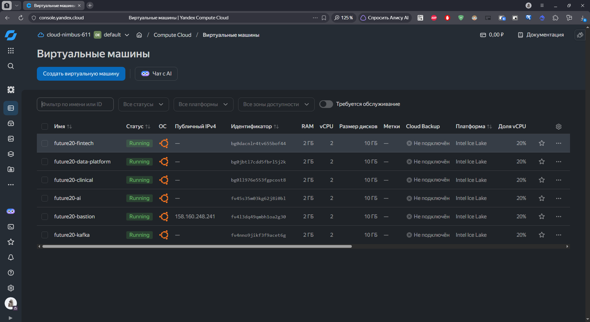
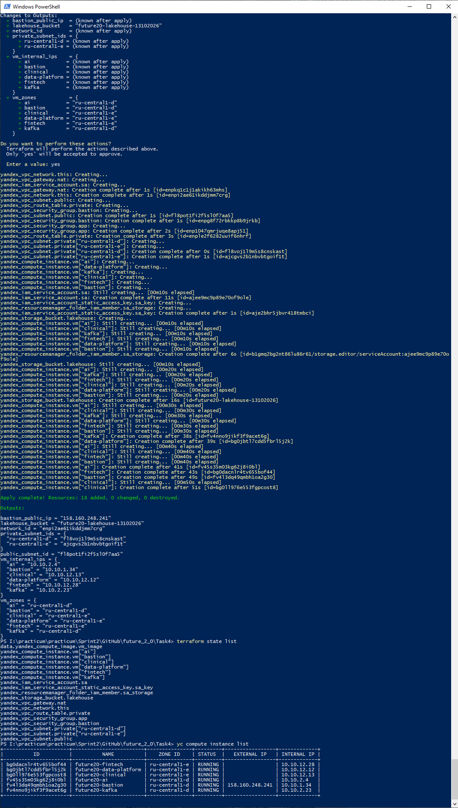

# Задание 3. Запуск конфигурации Terraform «Будущее 2.0»

## 1. Выбор облака и зоны

Конфигурация использует Yandex Cloud. В связи с аварийным режимом работы зон
`ru-central1-a` и `ru-central1-b` все ресурсы распределены в доступных зонах
`ru-central1-d` и `ru-central1-e`. Это обеспечивает успешное создание ВМ и
соответствует текущим ограничениям платформы.

## 2. Сетевая архитектура

Создаются:
- публичная подсеть `10.10.1.0/24` в `ru-central1-d` — для bastion-хоста;
- приватная подсеть `10.10.2.0/24` в `ru-central1-d` — для kafka и ai;
- приватная подсеть `10.10.12.0/24` в `ru-central1-e` — для data-platform, fintech и clinical.

## 3. ВМ и диски

| ВМ            | Зона          | vCPU | RAM   | Диск      | Назначение                   |
|---------------|---------------|------|-------|-----------|------------------------------|
| bastion       | ru-central1-d | 2    | 2 ГБ  | 10 ГБ HDD | SSH-доступ, jump-host        |
| kafka         | ru-central1-d | 2    | 2 ГБ  | 10 ГБ HDD | событийная шина              |
| data-platform | ru-central1-e | 2    | 2 ГБ  | 10 ГБ HDD | Lakehouse, витрины, портал   |
| fintech       | ru-central1-e | 2    | 2 ГБ  | 10 ГБ HDD | финтех-сервисы               |
| ai            | ru-central1-d | 2    | 2 ГБ  | 10 ГБ SSD | ML-пайплайны, ИИ-сервисы     |
| clinical      | ru-central1-e | 2    | 2 ГБ  | 10 ГБ SSD | операционные сервисы клиник  |

Диски, vCPU, RAM сокращены до минимума в 10 ГБ, чтобы уложиться в квоты Yandex Cloud и обойти
ограничения `ResourceExhausted`. Типы дисков распределены так, чтобы уложиться в аварийные лимиты по SSD и HDD.


## Результат развёртывания



<details> <summary> Лог развёртывания учебной инфраструктуры  terraform apply </summary>

```
PS I:\practicum\practicum\Sprint2\GitHub\future_2_0\Task4> terraform apply
data.yandex_compute_image.vm_image: Reading...
data.yandex_compute_image.vm_image: Read complete after 0s [id=fd8iej0ml2kuiu1tq40u]

Terraform used the selected providers to generate the following execution plan. Resource actions are indicated with the following
symbols:
  + create

Terraform will perform the following actions:

  # yandex_compute_instance.vm["ai"] will be created
  + resource "yandex_compute_instance" "vm" {
      + created_at                = (known after apply)
      + folder_id                 = "b1gmq2bg2nt86lu86r61"
      + fqdn                      = (known after apply)
      + gpu_cluster_id            = (known after apply)
      + hardware_generation       = (known after apply)
      + hostname                  = (known after apply)
      + id                        = (known after apply)
      + maintenance_grace_period  = (known after apply)
      + maintenance_policy        = (known after apply)
      + metadata                  = {
          + "ssh-keys" = "ubuntu:ssh-rsa AAAAC3NzaC1lZDI1NTE5AAAAIPKGv5Kc4AOc6MRU10erRadOSCHksngKCEIvr1uSFl6s sergio911@yandex.ru"
        }
      + name                      = "future20-ai"
      + network_acceleration_type = "standard"
      + platform_id               = "standard-v3"
      + reserved_instance_pool_id = (known after apply)
      + status                    = (known after apply)
      + zone                      = "ru-central1-d"

      + boot_disk {
          + auto_delete = true
          + device_name = (known after apply)
          + disk_id     = (known after apply)
          + mode        = (known after apply)

          + initialize_params {
              + block_size  = (known after apply)
              + description = (known after apply)
              + image_id    = "fd8iej0ml2kuiu1tq40u"
              + name        = (known after apply)
              + size        = 10
              + snapshot_id = (known after apply)
              + type        = "network-ssd"
            }
        }

      + metadata_options (known after apply)

      + network_interface {
          + index              = (known after apply)
          + ip_address         = (known after apply)
          + ipv4               = true
          + ipv6               = (known after apply)
          + ipv6_address       = (known after apply)
          + mac_address        = (known after apply)
          + nat                = false
          + nat_ip_address     = (known after apply)
          + nat_ip_version     = (known after apply)
          + security_group_ids = (known after apply)
          + subnet_id          = (known after apply)
        }

      + placement_policy (known after apply)

      + resources {
          + core_fraction = 20
          + cores         = 2
          + memory        = 2
        }

      + scheduling_policy (known after apply)
    }

  # yandex_compute_instance.vm["bastion"] will be created
  + resource "yandex_compute_instance" "vm" {
      + created_at                = (known after apply)
      + folder_id                 = "b1gmq2bg2nt86lu86r61"
      + fqdn                      = (known after apply)
      + gpu_cluster_id            = (known after apply)
      + hardware_generation       = (known after apply)
      + hostname                  = (known after apply)
      + id                        = (known after apply)
      + maintenance_grace_period  = (known after apply)
      + maintenance_policy        = (known after apply)
      + metadata                  = {
          + "ssh-keys" = "ubuntu:ssh-rsa AAAAC3NzaC1lZDI1NTE5AAAAIPKGv5Kc4AOc6MRU10erRadOSCHksngKCEIvr1uSFl6s sergio911@yandex.ru"
        }
      + name                      = "future20-bastion"
      + network_acceleration_type = "standard"
      + platform_id               = "standard-v3"
      + reserved_instance_pool_id = (known after apply)
      + status                    = (known after apply)
      + zone                      = "ru-central1-d"

      + boot_disk {
          + auto_delete = true
          + device_name = (known after apply)
          + disk_id     = (known after apply)
          + mode        = (known after apply)

          + initialize_params {
              + block_size  = (known after apply)
              + description = (known after apply)
              + image_id    = "fd8iej0ml2kuiu1tq40u"
              + name        = (known after apply)
              + size        = 10
              + snapshot_id = (known after apply)
              + type        = "network-hdd"
            }
        }

      + metadata_options (known after apply)

      + network_interface {
          + index              = (known after apply)
          + ip_address         = (known after apply)
          + ipv4               = true
          + ipv6               = (known after apply)
          + ipv6_address       = (known after apply)
          + mac_address        = (known after apply)
          + nat                = true
          + nat_ip_address     = (known after apply)
          + nat_ip_version     = (known after apply)
          + security_group_ids = (known after apply)
          + subnet_id          = (known after apply)
        }

      + placement_policy (known after apply)

      + resources {
          + core_fraction = 20
          + cores         = 2
          + memory        = 2
        }

      + scheduling_policy (known after apply)
    }

  # yandex_compute_instance.vm["clinical"] will be created
  + resource "yandex_compute_instance" "vm" {
      + created_at                = (known after apply)
      + folder_id                 = "b1gmq2bg2nt86lu86r61"
      + fqdn                      = (known after apply)
      + gpu_cluster_id            = (known after apply)
      + hardware_generation       = (known after apply)
      + hostname                  = (known after apply)
      + id                        = (known after apply)
      + maintenance_grace_period  = (known after apply)
      + maintenance_policy        = (known after apply)
      + metadata                  = {
          + "ssh-keys" = "ubuntu:ssh-rsa AAAAC3NzaC1lZDI1NTE5AAAAIPKGv5Kc4AOc6MRU10erRadOSCHksngKCEIvr1uSFl6s sergio911@yandex.ru"
        }
      + name                      = "future20-clinical"
      + network_acceleration_type = "standard"
      + platform_id               = "standard-v3"
      + reserved_instance_pool_id = (known after apply)
      + status                    = (known after apply)
      + zone                      = "ru-central1-e"

      + boot_disk {
          + auto_delete = true
          + device_name = (known after apply)
          + disk_id     = (known after apply)
          + mode        = (known after apply)

          + initialize_params {
              + block_size  = (known after apply)
              + description = (known after apply)
              + image_id    = "fd8iej0ml2kuiu1tq40u"
              + name        = (known after apply)
              + size        = 10
              + snapshot_id = (known after apply)
              + type        = "network-ssd"
            }
        }

      + metadata_options (known after apply)

      + network_interface {
          + index              = (known after apply)
          + ip_address         = (known after apply)
          + ipv4               = true
          + ipv6               = (known after apply)
          + ipv6_address       = (known after apply)
          + mac_address        = (known after apply)
          + nat                = false
          + nat_ip_address     = (known after apply)
          + nat_ip_version     = (known after apply)
          + security_group_ids = (known after apply)
          + subnet_id          = (known after apply)
        }

      + placement_policy (known after apply)

      + resources {
          + core_fraction = 20
          + cores         = 2
          + memory        = 2
        }

      + scheduling_policy (known after apply)
    }

  # yandex_compute_instance.vm["data-platform"] will be created
  + resource "yandex_compute_instance" "vm" {
      + created_at                = (known after apply)
      + folder_id                 = "b1gmq2bg2nt86lu86r61"
      + fqdn                      = (known after apply)
      + gpu_cluster_id            = (known after apply)
      + hardware_generation       = (known after apply)
      + hostname                  = (known after apply)
      + id                        = (known after apply)
      + maintenance_grace_period  = (known after apply)
      + maintenance_policy        = (known after apply)
      + metadata                  = {
          + "ssh-keys" = "ubuntu:ssh-rsa AAAAC3NzaC1lZDI1NTE5AAAAIPKGv5Kc4AOc6MRU10erRadOSCHksngKCEIvr1uSFl6s sergio911@yandex.ru"
        }
      + name                      = "future20-data-platform"
      + network_acceleration_type = "standard"
      + platform_id               = "standard-v3"
      + reserved_instance_pool_id = (known after apply)
      + status                    = (known after apply)
      + zone                      = "ru-central1-e"

      + boot_disk {
          + auto_delete = true
          + device_name = (known after apply)
          + disk_id     = (known after apply)
          + mode        = (known after apply)

          + initialize_params {
              + block_size  = (known after apply)
              + description = (known after apply)
              + image_id    = "fd8iej0ml2kuiu1tq40u"
              + name        = (known after apply)
              + size        = 10
              + snapshot_id = (known after apply)
              + type        = "network-hdd"
            }
        }

      + metadata_options (known after apply)

      + network_interface {
          + index              = (known after apply)
          + ip_address         = (known after apply)
          + ipv4               = true
          + ipv6               = (known after apply)
          + ipv6_address       = (known after apply)
          + mac_address        = (known after apply)
          + nat                = false
          + nat_ip_address     = (known after apply)
          + nat_ip_version     = (known after apply)
          + security_group_ids = (known after apply)
          + subnet_id          = (known after apply)
        }

      + placement_policy (known after apply)

      + resources {
          + core_fraction = 20
          + cores         = 2
          + memory        = 2
        }

      + scheduling_policy (known after apply)
    }

  # yandex_compute_instance.vm["fintech"] will be created
  + resource "yandex_compute_instance" "vm" {
      + created_at                = (known after apply)
      + folder_id                 = "b1gmq2bg2nt86lu86r61"
      + fqdn                      = (known after apply)
      + gpu_cluster_id            = (known after apply)
      + hardware_generation       = (known after apply)
      + hostname                  = (known after apply)
      + id                        = (known after apply)
      + maintenance_grace_period  = (known after apply)
      + maintenance_policy        = (known after apply)
      + metadata                  = {
          + "ssh-keys" = "ubuntu:ssh-rsa AAAAC3NzaC1lZDI1NTE5AAAAIPKGv5Kc4AOc6MRU10erRadOSCHksngKCEIvr1uSFl6s sergio911@yandex.ru"
        }
      + name                      = "future20-fintech"
      + network_acceleration_type = "standard"
      + platform_id               = "standard-v3"
      + reserved_instance_pool_id = (known after apply)
      + status                    = (known after apply)
      + zone                      = "ru-central1-e"

      + boot_disk {
          + auto_delete = true
          + device_name = (known after apply)
          + disk_id     = (known after apply)
          + mode        = (known after apply)

          + initialize_params {
              + block_size  = (known after apply)
              + description = (known after apply)
              + image_id    = "fd8iej0ml2kuiu1tq40u"
              + name        = (known after apply)
              + size        = 10
              + snapshot_id = (known after apply)
              + type        = "network-hdd"
            }
        }

      + metadata_options (known after apply)

      + network_interface {
          + index              = (known after apply)
          + ip_address         = (known after apply)
          + ipv4               = true
          + ipv6               = (known after apply)
          + ipv6_address       = (known after apply)
          + mac_address        = (known after apply)
          + nat                = false
          + nat_ip_address     = (known after apply)
          + nat_ip_version     = (known after apply)
          + security_group_ids = (known after apply)
          + subnet_id          = (known after apply)
        }

      + placement_policy (known after apply)

      + resources {
          + core_fraction = 20
          + cores         = 2
          + memory        = 2
        }

      + scheduling_policy (known after apply)
    }

  # yandex_compute_instance.vm["kafka"] will be created
  + resource "yandex_compute_instance" "vm" {
      + created_at                = (known after apply)
      + folder_id                 = "b1gmq2bg2nt86lu86r61"
      + fqdn                      = (known after apply)
      + gpu_cluster_id            = (known after apply)
      + hardware_generation       = (known after apply)
      + hostname                  = (known after apply)
      + id                        = (known after apply)
      + maintenance_grace_period  = (known after apply)
      + maintenance_policy        = (known after apply)
      + metadata                  = {
          + "ssh-keys" = "ubuntu:ssh-rsa AAAAC3NzaC1lZDI1NTE5AAAAIPKGv5Kc4AOc6MRU10erRadOSCHksngKCEIvr1uSFl6s sergio911@yandex.ru"
        }
      + name                      = "future20-kafka"
      + network_acceleration_type = "standard"
      + platform_id               = "standard-v3"
      + reserved_instance_pool_id = (known after apply)
      + status                    = (known after apply)
      + zone                      = "ru-central1-d"

      + boot_disk {
          + auto_delete = true
          + device_name = (known after apply)
          + disk_id     = (known after apply)
          + mode        = (known after apply)

          + initialize_params {
              + block_size  = (known after apply)
              + description = (known after apply)
              + image_id    = "fd8iej0ml2kuiu1tq40u"
              + name        = (known after apply)
              + size        = 10
              + snapshot_id = (known after apply)
              + type        = "network-hdd"
            }
        }

      + metadata_options (known after apply)

      + network_interface {
          + index              = (known after apply)
          + ip_address         = (known after apply)
          + ipv4               = true
          + ipv6               = (known after apply)
          + ipv6_address       = (known after apply)
          + mac_address        = (known after apply)
          + nat                = false
          + nat_ip_address     = (known after apply)
          + nat_ip_version     = (known after apply)
          + security_group_ids = (known after apply)
          + subnet_id          = (known after apply)
        }

      + placement_policy (known after apply)

      + resources {
          + core_fraction = 20
          + cores         = 2
          + memory        = 2
        }

      + scheduling_policy (known after apply)
    }

  # yandex_iam_service_account.sa will be created
  + resource "yandex_iam_service_account" "sa" {
      + created_at         = (known after apply)
      + description        = (known after apply)
      + expires_at         = (known after apply)
      + folder_id          = "b1gmq2bg2nt86lu86r61"
      + id                 = (known after apply)
      + labels             = (known after apply)
      + name               = "future20-sa"
      + service_account_id = (known after apply)
      + status             = (known after apply)
    }

  # yandex_iam_service_account_static_access_key.sa_key will be created
  + resource "yandex_iam_service_account_static_access_key" "sa_key" {
      + access_key                   = (known after apply)
      + created_at                   = (known after apply)
      + encrypted_secret_key         = (known after apply)
      + id                           = (known after apply)
      + key_fingerprint              = (known after apply)
      + output_to_lockbox_version_id = (known after apply)
      + secret_key                   = (sensitive value)
      + service_account_id           = (known after apply)
    }

  # yandex_resourcemanager_folder_iam_member.sa_storage will be created
  + resource "yandex_resourcemanager_folder_iam_member" "sa_storage" {
      + folder_id = "b1gmq2bg2nt86lu86r61"
      + id        = (known after apply)
      + member    = (known after apply)
      + role      = "storage.editor"
    }

  # yandex_storage_bucket.lakehouse will be created
  + resource "yandex_storage_bucket" "lakehouse" {
      + access_key            = (known after apply)
      + acl                   = (known after apply)
      + bucket                = "future20-lakehouse-13102026"
      + bucket_domain_name    = (known after apply)
      + default_storage_class = (known after apply)
      + folder_id             = "b1gmq2bg2nt86lu86r61"
      + force_destroy         = false
      + id                    = (known after apply)
      + policy                = (known after apply)
      + secret_key            = (sensitive value)
      + website_domain        = (known after apply)
      + website_endpoint      = (known after apply)

      + anonymous_access_flags (known after apply)

      + grant (known after apply)

      + versioning (known after apply)
    }

  # yandex_vpc_gateway.nat will be created
  + resource "yandex_vpc_gateway" "nat" {
      + created_at = (known after apply)
      + folder_id  = (known after apply)
      + id         = (known after apply)
      + labels     = (known after apply)
      + name       = "future20-vpc-nat"

      + shared_egress_gateway {}
    }

  # yandex_vpc_network.this will be created
  + resource "yandex_vpc_network" "this" {
      + created_at                = (known after apply)
      + default_security_group_id = (known after apply)
      + folder_id                 = (known after apply)
      + id                        = (known after apply)
      + labels                    = (known after apply)
      + name                      = "future20-vpc"
      + subnet_ids                = (known after apply)
    }

  # yandex_vpc_route_table.private will be created
  + resource "yandex_vpc_route_table" "private" {
      + created_at = (known after apply)
      + folder_id  = (known after apply)
      + id         = (known after apply)
      + labels     = (known after apply)
      + name       = "future20-vpc-private-rt"
      + network_id = (known after apply)

      + static_route {
          + destination_prefix = "0.0.0.0/0"
          + gateway_id         = (known after apply)
            # (1 unchanged attribute hidden)
        }
    }

  # yandex_vpc_security_group.app will be created
  + resource "yandex_vpc_security_group" "app" {
      + created_at = (known after apply)
      + folder_id  = (known after apply)
      + id         = (known after apply)
      + labels     = (known after apply)
      + name       = "future20-vpc-app-sg"
      + network_id = (known after apply)
      + status     = (known after apply)

      + egress {
          + description       = "any"
          + from_port         = -1
          + id                = (known after apply)
          + labels            = (known after apply)
          + port              = -1
          + protocol          = "ANY"
          + to_port           = -1
          + v4_cidr_blocks    = [
              + "0.0.0.0/0",
            ]
          + v6_cidr_blocks    = []
            # (2 unchanged attributes hidden)
        }

      + ingress {
          + description       = "SSH from bastion"
          + from_port         = -1
          + id                = (known after apply)
          + labels            = (known after apply)
          + port              = 22
          + protocol          = "TCP"
          + security_group_id = (known after apply)
          + to_port           = -1
          + v4_cidr_blocks    = []
          + v6_cidr_blocks    = []
            # (1 unchanged attribute hidden)
        }
      + ingress {
          + description       = "internal"
          + from_port         = -1
          + id                = (known after apply)
          + labels            = (known after apply)
          + port              = -1
          + protocol          = "ANY"
          + to_port           = -1
          + v4_cidr_blocks    = [
              + "10.10.1.0/24",
              + "10.10.2.0/24",
              + "10.10.12.0/24",
            ]
          + v6_cidr_blocks    = []
            # (2 unchanged attributes hidden)
        }
    }

  # yandex_vpc_security_group.bastion will be created
  + resource "yandex_vpc_security_group" "bastion" {
      + created_at = (known after apply)
      + folder_id  = (known after apply)
      + id         = (known after apply)
      + labels     = (known after apply)
      + name       = "future20-vpc-bastion-sg"
      + network_id = (known after apply)
      + status     = (known after apply)

      + egress {
          + description       = "any"
          + from_port         = -1
          + id                = (known after apply)
          + labels            = (known after apply)
          + port              = -1
          + protocol          = "ANY"
          + to_port           = -1
          + v4_cidr_blocks    = [
              + "0.0.0.0/0",
            ]
          + v6_cidr_blocks    = []
            # (2 unchanged attributes hidden)
        }

      + ingress {
          + description       = "SSH"
          + from_port         = -1
          + id                = (known after apply)
          + labels            = (known after apply)
          + port              = 22
          + protocol          = "TCP"
          + to_port           = -1
          + v4_cidr_blocks    = [
              + "0.0.0.0/0",
            ]
          + v6_cidr_blocks    = []
            # (2 unchanged attributes hidden)
        }
    }

  # yandex_vpc_subnet.private["ru-central1-d"] will be created
  + resource "yandex_vpc_subnet" "private" {
      + created_at     = (known after apply)
      + folder_id      = "b1gmq2bg2nt86lu86r61"
      + id             = (known after apply)
      + labels         = (known after apply)
      + name           = "future20-vpc-private-ru-central1-d"
      + network_id     = (known after apply)
      + route_table_id = (known after apply)
      + v4_cidr_blocks = [
          + "10.10.2.0/24",
        ]
      + v6_cidr_blocks = (known after apply)
      + zone           = "ru-central1-d"
    }

  # yandex_vpc_subnet.private["ru-central1-e"] will be created
  + resource "yandex_vpc_subnet" "private" {
      + created_at     = (known after apply)
      + folder_id      = "b1gmq2bg2nt86lu86r61"
      + id             = (known after apply)
      + labels         = (known after apply)
      + name           = "future20-vpc-private-ru-central1-e"
      + network_id     = (known after apply)
      + route_table_id = (known after apply)
      + v4_cidr_blocks = [
          + "10.10.12.0/24",
        ]
      + v6_cidr_blocks = (known after apply)
      + zone           = "ru-central1-e"
    }

  # yandex_vpc_subnet.public will be created
  + resource "yandex_vpc_subnet" "public" {
      + created_at     = (known after apply)
      + folder_id      = "b1gmq2bg2nt86lu86r61"
      + id             = (known after apply)
      + labels         = (known after apply)
      + name           = "future20-vpc-public"
      + network_id     = (known after apply)
      + v4_cidr_blocks = [
          + "10.10.1.0/24",
        ]
      + v6_cidr_blocks = (known after apply)
      + zone           = "ru-central1-d"
    }

Plan: 18 to add, 0 to change, 0 to destroy.

Changes to Outputs:
  + bastion_public_ip  = (known after apply)
  + lakehouse_bucket   = "future20-lakehouse-13102026"
  + network_id         = (known after apply)
  + private_subnet_ids = {
      + ru-central1-d = (known after apply)
      + ru-central1-e = (known after apply)
    }
  + vm_internal_ips    = {
      + ai            = (known after apply)
      + bastion       = (known after apply)
      + clinical      = (known after apply)
      + data-platform = (known after apply)
      + fintech       = (known after apply)
      + kafka         = (known after apply)
    }
  + vm_zones           = {
      + ai            = "ru-central1-d"
      + bastion       = "ru-central1-d"
      + clinical      = "ru-central1-e"
      + data-platform = "ru-central1-e"
      + fintech       = "ru-central1-e"
      + kafka         = "ru-central1-d"
    }

Do you want to perform these actions?
  Terraform will perform the actions described above.
  Only 'yes' will be accepted to approve.

  Enter a value: yes

yandex_vpc_network.this: Creating...
yandex_vpc_gateway.nat: Creating...
yandex_iam_service_account.sa: Creating...
yandex_vpc_gateway.nat: Creation complete after 1s [id=enpkq1c1j1akikh63mhs]
yandex_vpc_network.this: Creation complete after 1s [id=enpi2ae61ikddjmm7crg]
yandex_vpc_subnet.public: Creating...
yandex_vpc_route_table.private: Creating...
yandex_vpc_security_group.bastion: Creating...
yandex_vpc_subnet.public: Creation complete after 1s [id=fl8pot1fi2f5sl0f7aa5]
yandex_vpc_security_group.bastion: Creation complete after 1s [id=enpg8f72rbkkp8b9jrkb]
yandex_vpc_security_group.app: Creating...
yandex_vpc_security_group.app: Creation complete after 2s [id=enp1047qmrjuqe8apj51]
yandex_vpc_route_table.private: Creation complete after 3s [id=enple2f6282uuif6nhrf]
yandex_vpc_subnet.private["ru-central1-d"]: Creating...
yandex_vpc_subnet.private["ru-central1-e"]: Creating...
yandex_vpc_subnet.private["ru-central1-d"]: Creation complete after 0s [id=fl8voj1l9m5s8cnskast]
yandex_vpc_subnet.private["ru-central1-e"]: Creation complete after 1s [id=ajcgvs2b1nbvbtgoif1t]
yandex_compute_instance.vm["ai"]: Creating...
yandex_compute_instance.vm["data-platform"]: Creating...
yandex_compute_instance.vm["kafka"]: Creating...
yandex_compute_instance.vm["clinical"]: Creating...
yandex_compute_instance.vm["fintech"]: Creating...
yandex_compute_instance.vm["bastion"]: Creating...
yandex_iam_service_account.sa: Still creating... [00m10s elapsed]
yandex_iam_service_account.sa: Creation complete after 11s [id=ajee9mc9p89e70of9ole]
yandex_iam_service_account_static_access_key.sa_key: Creating...
yandex_resourcemanager_folder_iam_member.sa_storage: Creating...
yandex_iam_service_account_static_access_key.sa_key: Creation complete after 1s [id=aje2bhr5jbvr418tmbci]
yandex_storage_bucket.lakehouse: Creating...
yandex_compute_instance.vm["ai"]: Still creating... [00m10s elapsed]
yandex_compute_instance.vm["clinical"]: Still creating... [00m10s elapsed]
yandex_compute_instance.vm["kafka"]: Still creating... [00m10s elapsed]
yandex_compute_instance.vm["fintech"]: Still creating... [00m10s elapsed]
yandex_compute_instance.vm["data-platform"]: Still creating... [00m10s elapsed]
yandex_compute_instance.vm["bastion"]: Still creating... [00m10s elapsed]
yandex_resourcemanager_folder_iam_member.sa_storage: Creation complete after 6s [id=b1gmq2bg2nt86lu86r61/storage.editor/serviceAccount:ajee9mc9p89e70of9ole]
yandex_storage_bucket.lakehouse: Still creating... [00m10s elapsed]
yandex_compute_instance.vm["ai"]: Still creating... [00m20s elapsed]
yandex_compute_instance.vm["kafka"]: Still creating... [00m20s elapsed]
yandex_compute_instance.vm["fintech"]: Still creating... [00m20s elapsed]
yandex_compute_instance.vm["clinical"]: Still creating... [00m20s elapsed]
yandex_compute_instance.vm["data-platform"]: Still creating... [00m20s elapsed]
yandex_compute_instance.vm["bastion"]: Still creating... [00m20s elapsed]
yandex_storage_bucket.lakehouse: Creation complete after 16s [id=future20-lakehouse-13102026]
yandex_compute_instance.vm["ai"]: Still creating... [00m30s elapsed]
yandex_compute_instance.vm["clinical"]: Still creating... [00m30s elapsed]
yandex_compute_instance.vm["kafka"]: Still creating... [00m30s elapsed]
yandex_compute_instance.vm["data-platform"]: Still creating... [00m30s elapsed]
yandex_compute_instance.vm["fintech"]: Still creating... [00m30s elapsed]
yandex_compute_instance.vm["bastion"]: Still creating... [00m30s elapsed]
yandex_compute_instance.vm["kafka"]: Creation complete after 38s [id=fv4nno9jikf3f9acet6g]
yandex_compute_instance.vm["data-platform"]: Creation complete after 39s [id=bg0jbtl7cdd5fbrl5j2k]
yandex_compute_instance.vm["ai"]: Still creating... [00m40s elapsed]
yandex_compute_instance.vm["clinical"]: Still creating... [00m40s elapsed]
yandex_compute_instance.vm["fintech"]: Still creating... [00m40s elapsed]
yandex_compute_instance.vm["bastion"]: Still creating... [00m40s elapsed]
yandex_compute_instance.vm["ai"]: Creation complete after 41s [id=fv45s35m03kg62j8i0bl]
yandex_compute_instance.vm["fintech"]: Creation complete after 43s [id=bg0dacnlr4tv655bof44]
yandex_compute_instance.vm["bastion"]: Creation complete after 49s [id=fv4l3dq49qmbh1oa2g30]
yandex_compute_instance.vm["clinical"]: Still creating... [00m50s elapsed]
yandex_compute_instance.vm["clinical"]: Creation complete after 51s [id=bg0ll976e553fgpcost8]

Apply complete! Resources: 18 added, 0 changed, 0 destroyed.

Outputs:

bastion_public_ip = "158.160.248.241"
lakehouse_bucket = "future20-lakehouse-13102026"
network_id = "enpi2ae61ikddjmm7crg"
private_subnet_ids = {
  "ru-central1-d" = "fl8voj1l9m5s8cnskast"
  "ru-central1-e" = "ajcgvs2b1nbvbtgoif1t"
}
public_subnet_id = "fl8pot1fi2f5sl0f7aa5"
vm_internal_ips = {
  "ai" = "10.10.2.4"
  "bastion" = "10.10.1.34"
  "clinical" = "10.10.12.13"
  "data-platform" = "10.10.12.12"
  "fintech" = "10.10.12.28"
  "kafka" = "10.10.2.23"
}
vm_zones = {
  "ai" = "ru-central1-d"
  "bastion" = "ru-central1-d"
  "clinical" = "ru-central1-e"
  "data-platform" = "ru-central1-e"
  "fintech" = "ru-central1-e"
  "kafka" = "ru-central1-d"
}
PS I:\practicum\practicum\Sprint2\GitHub\future_2_0\Task4> terraform state list
data.yandex_compute_image.vm_image
yandex_compute_instance.vm["ai"]
yandex_compute_instance.vm["bastion"]
yandex_compute_instance.vm["clinical"]
yandex_compute_instance.vm["data-platform"]
yandex_compute_instance.vm["fintech"]
yandex_compute_instance.vm["kafka"]
yandex_iam_service_account.sa
yandex_iam_service_account_static_access_key.sa_key
yandex_resourcemanager_folder_iam_member.sa_storage
yandex_storage_bucket.lakehouse
yandex_vpc_gateway.nat
yandex_vpc_network.this
yandex_vpc_route_table.private
yandex_vpc_security_group.app
yandex_vpc_security_group.bastion
yandex_vpc_subnet.private["ru-central1-d"]
yandex_vpc_subnet.private["ru-central1-e"]
yandex_vpc_subnet.public
PS I:\practicum\practicum\Sprint2\GitHub\future_2_0\Task4> yc compute instance list
+----------------------+------------------------+---------------+---------+-----------------+-------------+
|          ID          |          NAME          |    ZONE ID    | STATUS  |   EXTERNAL IP   | INTERNAL IP |
+----------------------+------------------------+---------------+---------+-----------------+-------------+
| bg0dacnlr4tv655bof44 | future20-fintech       | ru-central1-e | RUNNING |                 | 10.10.12.28 |
| bg0jbtl7cdd5fbrl5j2k | future20-data-platform | ru-central1-e | RUNNING |                 | 10.10.12.12 |
| bg0ll976e553fgpcost8 | future20-clinical      | ru-central1-e | RUNNING |                 | 10.10.12.13 |
| fv45s35m03kg62j8i0bl | future20-ai            | ru-central1-d | RUNNING |                 | 10.10.2.4   |
| fv4l3dq49qmbh1oa2g30 | future20-bastion       | ru-central1-d | RUNNING | 158.160.248.241 | 10.10.1.34  |
| fv4nno9jikf3f9acet6g | future20-kafka         | ru-central1-d | RUNNING |                 | 10.10.2.23  |
+----------------------+------------------------+---------------+---------+-----------------+-------------+
```

</details>
<details> <summary> Снимок результата развёртывания учебной инфраструктуры </summary>



</details>